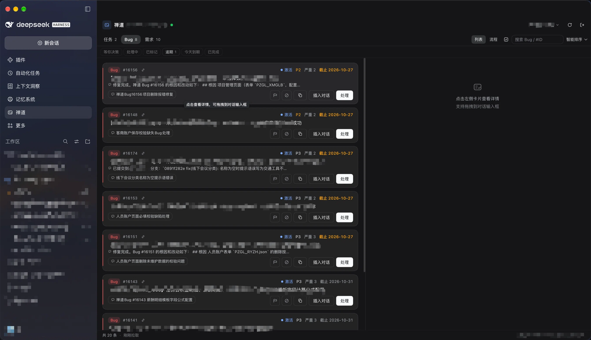

<div align="center">

# dsh-zentao-panel

**Bring ZenTao's "assigned to me" into DeepSeekRuntime: pick work, hand it to an agent, follow it, close the loop — without leaving DSH.**

[简体中文](README.md) · English

[](https://www.npmjs.com/package/dsh-zentao-panel)
[](https://www.npmjs.com/package/dsh-zentao-panel)
[](https://github.com/big-li99/dsh-zentao-panel/releases)
[](LICENSE)
[](https://github.com/deepseek-ai/deepseek-harness)

</div>

[Install](#install) · [Screenshots](#screenshots) · [Features](#features) · [How to use](#how-to-use) · [Compatibility](#compatibility) · [Known limitations](#known-limitations) · [Data and privacy](#data-and-privacy) · [Development](#development) · [Changelog](CHANGELOG.md)

A **ZenTao** icon appears in the DSH sidebar (same mechanism as the Memory System). Click it and the
ZenTao panel takes over the main area, listing the tasks / bugs / stories **assigned to you**. Pick one
and turn it into DSH conversation context — description, recent activity and screenshots included —
then hand it to an agent in the background, or open a session and send it yourself.

> The panel is **read-only**. It never calls a write API. Completing / resolving / closing an item still
> happens in ZenTao's own form, submitted by you.

## Screenshots



*The list view. Type color bar plus a fixed identity column, red for overdue and amber for due soon;
items that have been dispatched carry a session chip and a live status badge.*

## Why

The loop you probably run today: scan ZenTao, summarize it in your head, switch to DSH, describe it all
over again, then go back and update the status. The middle step loses information and wastes time.

- **One item, one context bundle**: title, description / steps to reproduce, colleagues' comments,
  workflow log, field old→new values and screenshots — packaged in one go.
- **No interruption while picking work**: "Process" runs in a background session; you stay in the panel
  and keep choosing. Cards light up with *running* / *needs your decision* / *done*.
- **Progress you don't have to remember**: state is stored locally and survives a DSH restart;
  decision requests raise a persistent notice, and you can answer right in the detail view.
- **The loop closes back in ZenTao**: when the agent is done, one deep link opens the ZenTao
  complete / resolve form for you to confirm.
- **Multiple accounts and instances**: keep your company ZenTao and another instance side by side and
  switch with one click in the header.

## Features

### List and search

- **Three categories + detail**: tasks / bugs / stories, each with list and detail views
  (description, screenshots, activity, notes).
- **Instant detail**: detail content is cached per account for 10 minutes, so reopening the same card
  paints immediately while a background refresh runs; "Reload" forces a fresh read. Opening the panel
  refreshes silently when a local snapshot exists, so no loading flash.
- **Item profile**: a small ownership line under each card title (execution for tasks, product for
  bugs/stories, plus module); detail adds project / execution / product / module / parent requirement /
  source bug (both link straight into ZenTao) and an effort row (estimated / consumed / left + a progress
  bar — bug reports carry no effort, so the row is hidden). All of it comes from requests already made.
- **Search**: title, `#ID`, status, creator and assignee in one haystack; multiple space-separated terms
  must all match.
- **Sort**: smart (default), by deadline, by priority, or original order. Smart sort ranks
  **needs-decision > running > overdue > due soon > has deadline > no deadline > done**, with items
  already closed in ZenTao pinned to the bottom.
- **Quick filter bar**: needs-decision / running / overdue / due today / done / flagged, one click each;
  counts follow the search box; the active filter spans all three categories.
- **Overdue and due-soon highlighting**: due within 3 days shows amber, overdue shows red, hover for the
  exact number of days; items in a terminal state stay neutral.
- **Instant open with offline fallback**: the list is snapshotted per account locally, so a restart or a
  remount shows the previous list immediately (footer shows the cache time) and refreshes in the
  background. If ZenTao is unreachable, the snapshot is the view.
- **Connection dot and background polling**: a small dot next to the title (green = connected, red =
  unreachable); the panel polls silently every 5 minutes while open and raises a toast for **new
  assignments** ("2 new assignments: 1 task · 1 bug"), remembered per account so it never repeats.
- **Board view**: a four-column pipeline (todo / running / needs decision / done-pending-close) for the
  whole picture, with light transitions that respect the system's reduce-motion setting; click a card to
  jump back to it in the list. The chosen view is remembered.

### Turning a card into conversation context

- **Process**: pick a workspace, provider/model and reasoning effort (defaulted to the current session's
  choice) in a dialog, then a new session is created and the task background is **sent automatically in
  the background**. The view does not jump; the card gains a session chip and live status.
- **New conversation**: same dialog, but it **jumps** to the new session and **does not send** — the
  draft is ready for you to review. The "bring task background" toggle (on by default, remembered)
  controls whether title, description, recent activity (up to 30 entries) and screenshots are filled in;
  turn it off to open an empty session instead.
- **Extra instructions and presets**: add a requirement (e.g. "find the root cause first, don't change
  code yet"), appended as a `## 处理要求` section; the last input is remembered and can be saved as one of
  up to 12 reusable preset chips.
- **Screenshots become real images**: `` tags in descriptions and comments (including the
  `{35861.png}` placeholders from the list API) are downloaded and attached to the message as DSH image
  attachments, so the model actually sees them.
- **Batch process / batch new conversation**: select items across categories in multi-select mode and
  send them as one merged background (up to 20 merged images); every card links to the same session.
- **Graceful degradation**: if a DSH service is missing, it falls back through "insert into the current
  session draft" → "write into the composer" → "copy to clipboard".
- **Drag and drop**: drag a card straight into the composer (compact Markdown: title + description).

### Status and reminders

- **Live badges**: blue *running* (three bouncing dots), amber *needs your decision*, green *done* with a
  persistent toast whose "Go look" button opens the session.
- **Two-way session links**: the card shows the linked session title and opens it on click; sessions that
  were dispatched from the panel get a "禅道" button in their header that jumps back and selects the card
  (switching accounts automatically when needed).
- **Persistent, correctable state**: state is stored locally and restored after a restart. Automatic
  detection can miss (deleted session, DSH restart, a session you were watching finish), so the card's
  status dropdown and the detail chip let you set running / needs-decision / done manually; "auto" goes
  back to following the linked session.
- **A manual terminal state, "ended"**: a finished run means *done*; after you have reviewed and wrapped up,
  mark it *ended* — it sinks to the bottom, greys out, and leaves overdue reminders and the board.
- **Decision console**: when a card needs your decision, the detail view lets you answer "approve, keep
  going" or type a custom reply without opening the session.
- **Reply preview and result read-back**: cards show one line of the agent's last reply; the detail view
  renders the full reply as Markdown in a capped scrolling area, read and cached automatically once done.
- **Continue**: append instructions to the **same** session instead of starting a new one.

### Detail and collaboration

- **Recent activity timeline**: comments, workflow events (assignment, transfer, status, priority,
  deadline changes) and field old→new values, collapsed to the latest 5 with an expand-all toggle;
  screenshots inside comments render as real images.
- **Two-layer image cache**: client (40 images / 24 MB) and host (10 min / 32 MB), so reopening a detail
  view, switching panels back, or processing a card that was already viewed never spins again.
- **Close the loop in ZenTao**: once a card shows a green check, the detail view offers "mark complete in
  ZenTao", deep-linking to `task-finish` / `bug-resolve` / `story-close` for you to submit.

### Efficiency

- **Local notes**: a memo per card (e.g. "waiting for Zhang"), local only, never written back.
- **Flags and hiding**: flag an item for attention (filterable), or hide it locally (filtered out by
  default, restorable from the footer).
- **Copy**: the card copies `#ID title` (handy for chat), the detail view copies the full Markdown.
- **Quick resend ⚡**: reuses the last successful workspace / model / effort / instruction and resends
  without the dialog.

### Multiple accounts

Keep several ZenTao accounts (same instance or different instances), switching / adding / removing them
from the header menu. Each account keeps its own cookie and caches, so switching is instant. Each account
can have an alias (✎ inline in the menu, ≤30 characters) shown on the header chip and the footer, with the
raw account and instance URL on the secondary line.

### UI and theme

A full-width sidebar panel that does not disappear when you switch sessions. Cards are a flat queue: type
color bar, a fixed "type / #ID" identity column, relative deadlines (today / tomorrow / in N days /
N days overdue), colored badges only for P1/P2. All colors use DSH semantic tokens (`--dsw-alias-*`) and
follow light / dark automatically. On older DSH builds without the required slots, the panel falls back to
an edge-floating button with a slide-over panel.

## Install

**Requires**: DeepSeekRuntime 0.2.1-rc.2 or newer (desktop), Node.js ≥ 22 (source / CLI install only).

### From the Plugins page

Sidebar → **Plugins** → **Add plugin** → enter `dsh-zentao-panel` (or a pinned version such as
`dsh-zentao-panel@0.4.1`) → install → restart DSH.

### Command line

```bash
# The macOS desktop app ships its own CLI; if `dsh` is on your PATH, use it directly
DSH="/Applications/DeepSeekRuntime.app/Contents/Resources/runtime/cli/bin/dsh"
"$DSH" plugin --profile desktop add dsh-zentao-panel
```

From source (development / tracking master):

```bash
git clone https://github.com/big-li99/dsh-zentao-panel.git
DSH="/Applications/DeepSeekRuntime.app/Contents/Resources/runtime/cli/bin/dsh"
"$DSH" plugin --profile desktop add "$(pwd)/dsh-zentao-panel"
```

**Restart DSH Desktop** afterwards. From then on, client-side changes apply with ⌘R (renderer reload);
host-side changes need a desktop restart (with a `link:` install you do not need to reinstall).

### Update

Re-run the same `add` on the command line to overwrite. If you installed through the graphical
installer, remove the old version before installing the new one.

### First check

1. A **ZenTao** icon appears in the sidebar (below the Memory System) — open it.
2. On first use, enter the ZenTao base URL (e.g. `http://zentao.example.com:8090`), account and password,
   then sign in.
3. Tasks / bugs / stories assigned to you appear, and the connection dot turns green.

The login cookie is persisted (`keepLogin`, 30 days), and an expired session triggers automatic re-login.

## How to use

1. **Pick**: search, filter and sort, then open a card for details and recent activity.
2. **Dispatch**: click **Process** to have an agent start right away in a background session, or
   **New conversation** to jump to a new session with the draft waiting for you. Both let you choose
   workspace, model, reasoning effort and an extra instruction first.
3. **Follow**: badges tell you running / needs your decision / done. Answer a decision in the detail view,
   or click the chip or notice to jump back to the session.
4. **Close**: when the agent is done, click "mark complete in ZenTao", submit the form, then mark the card
   *ended* back in the list.

## Compatibility

| DeepSeekRuntime (DSH) | dsh-zentao-panel | Verified on |
| :--- | :--- | :--- |
| **0.2.1-rc.3** | `0.4.1` | Desktop (macOS, current local environment) |
| **0.2.1-rc.2** | `0.4.1`, `0.4.0`, `0.3.0`, `0.2.1`, `0.2.0` | Desktop (macOS) |

ZenTao side: verified against **ZenTao 18.x open source** with PATH_INFO routing (18.13). The plugin only
uses the web login protocol, `/my-work-*.json` and `/api.php/v1/{tasks,bugs,stories}/{id}`; it does not
depend on RESTful v2 (which is entirely unavailable on that instance). Other versions and deployments are
not individually verified, but only standard ZenTao endpoints are used.

## Known limitations

- **Read-only.** There is no write API. Completing / resolving / closing happens in ZenTao by you
  (this is a deliberate boundary, not an oversight).
- **Images need a vision-capable model.** If the current model does not accept image input, DSH rejects the
  whole message — remove the attachments and send again.
- **Polling only happens while the panel is open.** After the panel unmounts (you switched to a session)
  the list is no longer refreshed; live session monitoring keeps running.
- **"Done" can lag by one beat.** The host only sets its completion-unread signal for **background**
  sessions. For a session you were watching, the plugin compensates by promoting a cleared "running"
  state with a confirmed end signal; long idle periods or time with DSH closed can still be missed —
  correct it with the card's status dropdown.
- **Links and progress are local only.** Card↔session links, status, notes and flags live in browser
  localStorage; a different browser or a cleared cache loses them (credentials live in `config.json` and
  are unaffected). They do not sync across machines.
- **8-hour cleanup.** Once a card leaves the "assigned to me" list in ZenTao (completed or reassigned),
  its links, status, reply summary, notes and flags are removed 8 hours later (short fluctuations during
  the day are not mistaken for removal).
- **A remount refetches.** The panel re-renders from the local snapshot instantly, then refreshes in the
  background.
- Deliberately out of scope: exposing an agent tool, a badge on the floating button, and any ZenTao write
  operation.

## Data and privacy

- The only persisted credential file is `$DSH_HOME/zentao-panel/config.json` (default
  `~/.dsh/zentao-panel/`, **mode 0600**; the password field is base64-obfuscated, not encrypted),
  schema v2:

  ```jsonc
  {
    "version": 2,
    "accounts": [ /* { id, baseUrl, account, alias?, password, cookies } */ ],
    "activeId": "id of the active account"
  }
  ```

  Account `id` is hashed from `baseUrl + account`; signing in again updates the credentials (the alias is
  kept). The legacy single-account format is migrated on read. Uninstalling the plugin does not delete
  this file.

- UI state lives in browser `localStorage` under the `dsh-zentao-panel.` prefix: `links`, `states`,
  `replies`, `mine`, `marks`, `notes`, `instr`, `instr-presets`, `carry`, `lastdispatch` (all `.v1`).
  See [architecture notes](docs/architecture.md#7-数据落在哪).

- Network: only the ZenTao base URL you configure is contacted; on the DSH side everything goes over
  loopback RPC (`POST /dsh-zentao-panel/*`, non-owner requests rejected by the trust gate).
  **Nothing is uploaded to any third party.**

- Cleanup after uninstalling: see [Uninstall](#uninstall).

## Uninstall

```bash
DSH="/Applications/DeepSeekRuntime.app/Contents/Resources/runtime/cli/bin/dsh"
"$DSH" plugin --profile desktop remove dsh-zentao-panel

# Optional: delete local credentials (not recoverable)
rm -rf ~/.dsh/zentao-panel
```

The `dsh-zentao-panel.*` localStorage entries can be cleared from DSH's site settings.

## Development

```
lib/                  host half (Node ESM, zero npm dependencies)
  index.js            apply(ctx) — inject: ['webServer', 'connection']
  zentao-client.mjs   ZenTao HTTP client (login protocol / cookies / my-work / v1 detail)
  service.mjs         multi-account aggregate (per-account client / caches / auto re-login)
  store.mjs           config.json persistence (0600, schema v2)
  rpc.mjs             loopback RPC (trust gate + path allowlist)
client/client.js      client half (build-free hand-written bundle, React via the DSH module system)
test/                 client / multi / protocol (offline) · smoke / host (real ZenTao)
docs/architecture.md  internals: data paths, slot registration, dispatch timing, pitfalls
计划书.md              original plan + ZenTao API reconnaissance (appendix A is authoritative)
```

Offline self-check (no DSH, no ZenTao needed):

```bash
node test/client.mjs      # 402 assertions: bundle load + registration contract + pure functions
node test/multi.mjs       # 41 assertions: multi-account store migration / switch / cache isolation / removal
node test/protocol.mjs    # 21 assertions: ZenTao response envelope, actions mapping, auto re-login
```

Integration suites that need an internal ZenTao instance are listed in
[docs/architecture.md §9](docs/architecture.md#9-验证).

**How it works** (details in the [architecture notes](docs/architecture.md)): the host half signs in with
ZenTao's web login protocol to obtain a 30-day cookie, then reads the list from `my-work`, details and
activity from the v1 API, and images from `file-read`. The client half registers a full-width panel in the
sidebar, renders a card as Markdown, and writes it into a new session draft through the `sessions` /
`conversation` service-level APIs, attaching images. Live state comes from the host's
`uiSession.sessionStatus` store with zero polling. RPC only listens on loopback and rejects non-owner
requests.

### Releasing

Bump `version` in `package.json`, cut the top section of `CHANGELOG.md`, then tag:

```bash
git commit -am "release: v0.4.1 — …"
git tag v0.4.1 && git push && git push --tags
```

[release.yml](.github/workflows/release.yml) creates a GitHub Release from the CHANGELOG section and
publishes to npm via **Trusted Publishing (OIDC, no long-lived token)**: a tag that disagrees with the
version fails the run, an already published version is skipped, pre-releases go to `next` and stable
releases to `latest`. The full checklist (screenshots, offline tests, publish verification) lives in the
project skill [`.dsh/skills/dsh-zentao-panel-release/SKILL.md`](.dsh/skills/dsh-zentao-panel-release/SKILL.md).

## License

[MIT](LICENSE)
