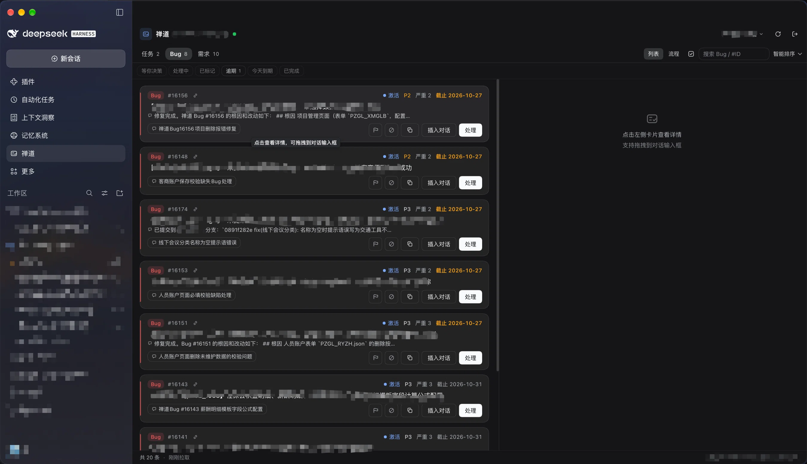

<div align="center">

# dsh-zentao-panel

**把禅道「指派给我」搬进 DeepSeekRuntime：挑活、下发、跟进度、闭环，全程不离开 DSH。**

简体中文 · [English](README.en.md)

[](https://www.npmjs.com/package/dsh-zentao-panel)
[](https://www.npmjs.com/package/dsh-zentao-panel)
[](https://github.com/big-li99/dsh-zentao-panel/releases)
[](LICENSE)
[](https://github.com/deepseek-ai/deepseek-harness)

</div>

[安装](#安装) · [效果预览](#效果预览) · [功能](#功能) · [使用](#使用) · [兼容性](#兼容性) · [已知限制](#已知限制) · [数据与隐私](#数据与隐私) · [开发](#开发) · [更新日志](CHANGELOG.md)

DSH 左侧栏多一个**禅道**图标（与「记忆系统」同款形式）——点开后禅道面板占满主区域，
列出**指派给你**的任务 / Bug / 需求。挑一条，把它的描述、最近动态和截图变成一份 DSH 对话
上下文：后台派给 agent 自动跑，或者新建会话等你确认再发。

> 面板**只读**：不调用任何写接口，完成 / 解决 / 关闭仍在禅道表单里由你亲手提交。

## 效果预览



*列表页实拍。左侧类型彩条 + 固定身份列，逾期红、临期橙，处理过的卡片带会话 chip 与活性徽标。*

## 为什么用它

你现在的循环大概是：禅道看一遍 → 脑子里整理 → 切到 DSH 重新描述一遍 → 回来改状态。
中间那步最容易漏信息，也最烦。

- **一条活就是一份上下文**：标题、描述 / 重现步骤、同事备注、流转记录、字段新旧值、截图，
  一次打包好递给 agent，不用手抄。
- **不打断挑活的节奏**：「处理」在后台新会话里跑，你留在面板继续选题；卡片会亮起
  「处理中 / 等你决策 / 已完成」。
- **进度不用自己记**：状态落本机，DSH 重启还在；等你决策时有提醒条，详情页能直接拍板。
- **闭环回到禅道**：agent 干完，详情页一键深链到禅道的完成 / 解决页，你确认提交即可。
- **多账号 / 多实例**：公司禅道和另一个实例可以各存一份，头部一键切换。

## 功能

### 列表与检索

- **三个分类 + 详情**：任务 / Bug / 需求分段标签，卡片列表与详情（描述、截图、动态、备注）。
- **详情秒开**：详情内容按账号缓存 10 分钟，点开同一张卡立刻出内容、后台静默刷新，
  「重新读取」可随时拉最新；打开面板时已有快照就**静默刷新**，不再闪加载。
- **事项档案**：卡片标题下带一行归属（任务看所属执行、Bug/需求看所属产品，附模块名）；详情补出
  项目 / 执行 / 产品 / 模块 / 需求来源 / 来源 Bug（可直接点开禅道），以及工时口径
  （预计 / 已耗 / 剩余 + 进度条；Bug 不记工时不显示）。字段都来自已有接口，不多打请求。
- **搜索**：标题、`#ID`、状态、创建人、指派人一起匹配，多关键词空格分隔（全命中才显示）。
- **排序**：智能排序（默认）、按截止、按优先级、默认顺序。智能排序会把
  **等你决策 > 处理中 > 逾期 > 临期 > 有截止 > 无截止 > 已完成**排进优先级，禅道侧终态沉底。
- **快捷筛选条**：等你决策 / 处理中 / 逾期 / 今天到期 / 已完成 / 已标记，一键过滤，计数随搜索联动；
  激活时跨分类合并展示。
- **逾期与临期高亮**：截止临期（≤3 天）橙色、逾期红色，悬停看逾期天数；终态卡片不着色。
- **秒开与离线兜底**：列表按账号快照在本机，重启或重开面板先显示上次列表（页脚标「HH:mm 缓存」），
  再后台刷新；禅道暂时连不上时旧数据即兜底视图。
- **在线状态 + 自动轮询**：标题旁连接小点（绿 = 已连 / 红 = 不可达），面板打开时每 5 分钟静默刷新；
  发现**新指派**弹提醒（「禅道新指派 2 条（任务×1 · Bug×1）」），按账号记忆不重复提醒。
- **流程看板**：四站管线（待处理 / 处理中 / 等你决策 / 已完成待闭环）同屏看全局，卡片换列时有轻量动效
  （遵循系统「减少动态效果」）；点缩略卡回列表定位，视图选择自动记忆。

### 转成对话上下文

- **「处理」**：弹层选工作区、接入的模型（按提供方分组）、思考强度（默认带出当前会话在用项），
  确认后**新建会话并在后台自动发送**——视图不跳转，卡片上出现该会话的 chip 与状态。
- **「新建对话」**：同样选工作区 / 模型 / 思考强度，但**自动跳转**到新会话且**不自动发送**，
  草稿已就位等你检查。弹层的「自动带入任务背景」开关（默认勾选、记住上次选择）：
  勾选时带入标题、描述、最近动态（最多 30 条）与截图；取消则只开一个空白会话。
- **附加指令 + 模板预设**：弹层里写一句要求（如「只分析定位原因，先不要改代码」），
  以 `## 处理要求` 拼到背景末尾；记住上次输入，并可存成多套模板 chip 一键填入（≤12 条）。
- **截图变成真实图片**：描述与备注里的 ``（含列表接口的 `{35861.png}` 占位符）会被下载、
  作为 DSH 图片附件挂到消息上，模型真的能看到图。
- **批量处理 / 批量新建对话**：多选模式跨分类勾一批活，合并成一份背景一次下发（图片合并上限 20 张）；
  每张卡片都关联同一会话。
- **降级不丢内容**：DSH 服务缺失时依次退回「插入当前会话草稿 → 写 composer → 复制到剪贴板」。
- **拖拽**：卡片可直接拖进对话输入框（精简 Markdown：标题 + 描述）。

### 处理状态与提醒

- **活性徽标**：会话在跑 → 蓝色「处理中」（三点跳动）；agent 等你拍板 → 琥珀「等你决策」；
  后台跑完 → 绿色「已完成」徽标 + 常驻提醒条，点「去看看」跳回该会话。
- **会话 chip 双向跳转**：卡片上显示关联会话标题，点击跳过去；处理过的会话头部有「禅道」按钮，
  点击切回面板并选中该卡片（跨账号自动切换）。
- **进度持久化 + 手动修正**：状态存本机，重启后徽标恢复；自动检测偶尔会丢（会话被删 / 重启 /
  正看着的会话跑完），可用卡片「状态」下拉或详情 chip 手动改成 处理中 / 等你决策 / 已完成，
  选「自动」恢复跟随信号。
- **人工终态「已结束」**：会话跑完只是「已完成」，你验收收摊后再标「已结束」——列表沉底灰化，
  不再参与逾期提醒与看板。
- **决策应答台**：卡片「等你决策」时，详情页可一键「同意，继续执行」或自定义答复，不用跳会话。
- **回复摘要与结果回读**：列表卡片显示 agent 最后回复的一行预览；详情页可看完整回复
  （markdown 渲染、限高滚动），「已完成」后自动读取并缓存。
- **继续处理**：往**原来那个会话**追加指令接着跑，不开新会话丢上下文。

### 详情与协作

- **最近动态时间线**：同事备注、流转记录（指派 / 转派 / 状态 / 优先级 / 截止变更）、字段新旧值对照，
  默认折叠显示最近 5 条、可展开全部；备注里的截图同样以真实图片渲染。
- **图片双层缓存**：看过的截图 client 40 张 / 24MB + host 10 分钟 / 32MB 各留一份，
  重开详情、面板切回、点「处理」都不再重新转圈。
- **完成后去禅道闭环**：卡片绿勾后详情页出现「去禅道标记完成」，深链到
  `task-finish` / `bug-resolve` / `story-close` 操作页，由你确认提交。

### 效率与整理

- **本地备注**：卡片自己的备忘（如「等张三回复后再动」），只在本机，不回写禅道。
- **旗标与隐藏**：打旗标重点关注（「已标记」可筛选），或本地隐藏（默认滤掉，页脚可找回）。
- **一键复制**：卡片复制 `#ID 标题`（贴 IM 问同事），详情复制完整 Markdown。
- **极速重发 ⚡**：记住上次成功下发的工作区 / 模型 / 思考强度 / 附加指令，同类问题一键重发不过弹层。

### 多账号

可保存多个禅道账号（同实例换账号、多实例混用都行），头部账号菜单切换 / 添加 / 按账号移除；
每账号独立 cookie 与缓存，切换即时生效。每个账号可设**别名**（菜单里点 ✎ 行内编辑，≤30 字），
chip 与页脚优先显示别名，原账号 + 实例地址下沉副行。

### 界面与主题

左侧栏全局面板（不随会话切换而消失），卡片是平铺队列样式：类型彩条 + 固定「类型 / #ID」身份列，
截止用相对说法（今天 / 明天 / N 天后 / 逾期 N 天），P1/P2 才用彩色徽标；颜色全部走 DSH 语义 token
（`--dsw-alias-*`），日间 / 夜间自动跟随。旧版 DSH 没有对应 slot 时自动退回右缘悬浮按钮 + 侧滑面板。

## 安装

**要求**：DeepSeekRuntime 0.2.1-rc.2 及以上（桌面版）、Node.js ≥ 22（仅源码 / CLI 安装时需要）。

### 图形界面（推荐）

侧栏「插件」页 →「添加插件」→ 填入 `dsh-zentao-panel`（或指定版本 `dsh-zentao-panel@0.4.1`）→
安装 → 重启 DSH。

### 命令行

```bash
# macOS 桌面版自带 CLI；若 `dsh` 已在 PATH 上，直接用 dsh 即可
DSH="/Applications/DeepSeekRuntime.app/Contents/Resources/runtime/cli/bin/dsh"
"$DSH" plugin --profile desktop add dsh-zentao-panel
```

从源码装（开发 / 跟踪 master）：

```bash
git clone https://github.com/big-li99/dsh-zentao-panel.git
DSH="/Applications/DeepSeekRuntime.app/Contents/Resources/runtime/cli/bin/dsh"
"$DSH" plugin --profile desktop add "$(pwd)/dsh-zentao-panel"
```

装完**重启 DSH Desktop**。之后：client 侧改动 ⌘R 重载渲染进程即生效；host 侧改动需重启桌面版
（若用 `link:` 安装则不用重新安装，目录改动直接生效）。

### 更新

命令行重装同一条 `add` 即覆盖；若用图形界面安装，建议先移除旧版本再装新版本。

### 首次验证

1. 左侧栏出现**禅道**图标（在「记忆系统」下方），点开面板；
2. 首次使用填禅道地址（如 `http://zentao.example.com:8090`）、账号、密码 → 登录；
3. 列表出现「指派给我」的任务 / Bug / 需求即成功；右上连接小点应为绿色。

登录态持久化（`keepLogin` cookie，30 天免登），会话失效会自动重登。

## 使用

1. **挑活**：面板里搜索 / 筛选 / 看排序，点卡片看详情与最近动态。
2. **下发**：想让它直接干 → 点「处理」（后台新会话自动跑）；想先看一眼再发 → 点「新建对话」
   （跳过去，草稿待你确认）。两者都能先选工作区、模型、思考强度和附加指令。
3. **跟进度**：卡片徽标告诉你处理中 / 等你决策 / 已完成；「等你决策」可直接在详情页答，
   也能点 chip 或提醒条跳回会话。
4. **闭环**：agent 干完，详情页点「去禅道标记完成」在禅道表单里提交，回到列表可把卡片标「已结束」。

## 兼容性

| DeepSeekRuntime (DSH) | dsh-zentao-panel | 验证环境 |
| :--- | :--- | :--- |
| **0.2.1-rc.3** | `0.4.1` | 桌面版（macOS，本机现行环境） |
| **0.2.1-rc.2** | `0.4.1`, `0.4.0`, `0.3.0`, `0.2.1`, `0.2.0` | 桌面版（macOS） |

禅道侧：**ZenTao 18.x 开源版**、PATH_INFO 路由实例实测（18.13）。插件只用网页登录协议、
`/my-work-*.json` 与 `/api.php/v1/{tasks,bugs,stories}/{id}`，不依赖 RESTful v2
（该实例上 v2 整个不可用）。其他版本/部署形态未逐个验证，但走的都是标准禅道接口。

## 已知限制

- **只读**：插件不提供任何回写禅道的 API，完成 / 解决 / 关闭都由你在禅道页面提交（这也是刻意的边界）。
- **图片需要支持视觉的模型**：当前模型不支持图片输入时，DSH 会拒绝整条消息——在输入框去掉图片附件再发。
- **轮询只在面板打开时做**：面板卸载（切回会话）后不再拉列表；会话活性监控则常驻。
- **「已完成」可能晚一拍**：宿主的完成未读信号只对**后台**会话置位。正看着的会话跑完后，
  插件靠「处理中归零 + 结束确认信号」补偿记为已完成；长时间空闲、DSH 关闭期间的状态仍可能漏，
  这时用卡片「状态」下拉手动修正。
- **关联与进度只在本机**：卡片与会话的关联、状态、备注、旗标存在浏览器 localStorage，
  换浏览器 / 清缓存会丢（凭据在 `config.json` 里，不受影响）。同一账号在多台机器上互不同步。
- **离开列表 8 小时后清理**：卡片在禅道里完结 / 转派、不再出现在「指派给我」后，
  其关联会话、状态、回复摘要、备注、旗标在 8 小时后一并清理（当天短暂波动不会误删）。
- **面板重挂会重新拉一次列表**：先用本机快照秒开，再后台刷新。
- 刻意不做：agent 工具（不暴露为模型可调用的工具）、悬浮按钮角标、禅道写操作。

## 数据与隐私

- 唯一落盘的凭据在 `$DSH_HOME/zentao-panel/config.json`（默认 `~/.dsh/zentao-panel/`，
  **权限 0600**，密码字段仅做 base64 混淆、不是加密），schema v2：

  ```jsonc
  {
    "version": 2,
    "accounts": [ /* { id, baseUrl, account, alias?, password, cookies } */ ],
    "activeId": "当前激活账号的 id"
  }
  ```

  账号 `id` 由 `baseUrl + account` 哈希得到；同账号重复登录等于更新凭据（别名保留）。
  旧版单账号格式读取时自动迁移。卸载插件不会删除这个文件。

- 界面状态在浏览器 `localStorage`（键前缀 `dsh-zentao-panel.`）：`links` / `states` / `replies` /
  `mine` / `marks` / `notes` / `instr` / `instr-presets` / `carry` / `lastdispatch`，
  全部是 `.v1` 后缀的本机数据。详见[架构文档](docs/architecture.md#7-数据落在哪)。

- 网络：只连接你填写的禅道地址；DSH 侧走 loopback RPC（`POST /dsh-zentao-panel/*`，
  非 owner 请求被信任栅栏拒绝）。**不上传任何第三方服务。**

- 卸载后清理：[卸载](#卸载)里给出删除凭据目录的命令。

## 卸载

```bash
DSH="/Applications/DeepSeekRuntime.app/Contents/Resources/runtime/cli/bin/dsh"
"$DSH" plugin --profile desktop remove dsh-zentao-panel

# 可选：清除本机凭据（不可恢复）
rm -rf ~/.dsh/zentao-panel
```

浏览器里 `dsh-zentao-panel.*` 的 localStorage 数据可在 DSH 站点设置中清除。

## 开发

```
lib/                  host 半边（Node ESM，零 npm 依赖）
  index.js            apply(ctx) —— inject: ['webServer', 'connection']
  zentao-client.mjs   禅道 HTTP 客户端（登录协议 / cookie / my-work / v1 详情）
  service.mjs         多账号聚合（每账号独立 client / 缓存 / 自动重登）
  store.mjs           config.json 持久化（0600，schema v2）
  rpc.mjs             loopback RPC（信任栅栏 + 路径白名单）
client/client.js      client 半边（免构建手写 bundle，React 走 DSH 模块系统）
test/                 client / multi / protocol（离线）· smoke / host（需真实禅道）
docs/architecture.md  实现细节：数据链路、slot 注册、下发时序、坑清单
计划书.md             原始计划 + 禅道 API 探测记录（附录 A 是协议权威记录）
```

自检（离线，不需要 DSH 也不需要禅道）：

```bash
node test/client.mjs      # 402 项：bundle 装载 + 注册契约 + 纯函数
node test/multi.mjs       # 41 项：多账号 store 迁移 / 切换 / 缓存隔离 / 移除
node test/protocol.mjs    # 21 项：禅道响应信封协议 + actions 映射 + 自动重登
```

需要内网禅道的集成测试见 [docs/architecture.md §9](docs/architecture.md#9-验证)。

**工作原理**（细节在[架构文档](docs/architecture.md)）：host 用网页登录协议拿 30 天 cookie，
走 `my-work` 三接口取列表、v1 接口取详情与动态、`file-read` 取图片；client 在左侧栏注册一个
全局面板，把卡片渲染成 Markdown，经 `sessions` / `conversation` 服务级 API 写入新会话草稿并挂图片附件；
处理状态来自宿主 `uiSession.sessionStatus`，零轮询。RPC 只监听 loopback，非 owner 请求直接拒绝。

### 发版

改 `package.json` 的 `version` + 切 `CHANGELOG.md` 顶部小节，然后打 tag：

```bash
git commit -am "release: v0.4.1 — …"
git tag v0.4.1 && git push && git push --tags
```

[release.yml](.github/workflows/release.yml) 会从 CHANGELOG 抽段建 GitHub Release，并用
**npm 信任发布（Trusted Publishing / OIDC，无需长期 token）**发 npm：tag 与版本不一致直接失败、
版本已存在则跳过、预发布发 `next`、正式版发 `latest`。完整步骤（截图入仓、离线测试、发布核对）见
项目技能 [`.dsh/skills/dsh-zentao-panel-release/SKILL.md`](.dsh/skills/dsh-zentao-panel-release/SKILL.md)。

## 许可

[MIT](LICENSE)
